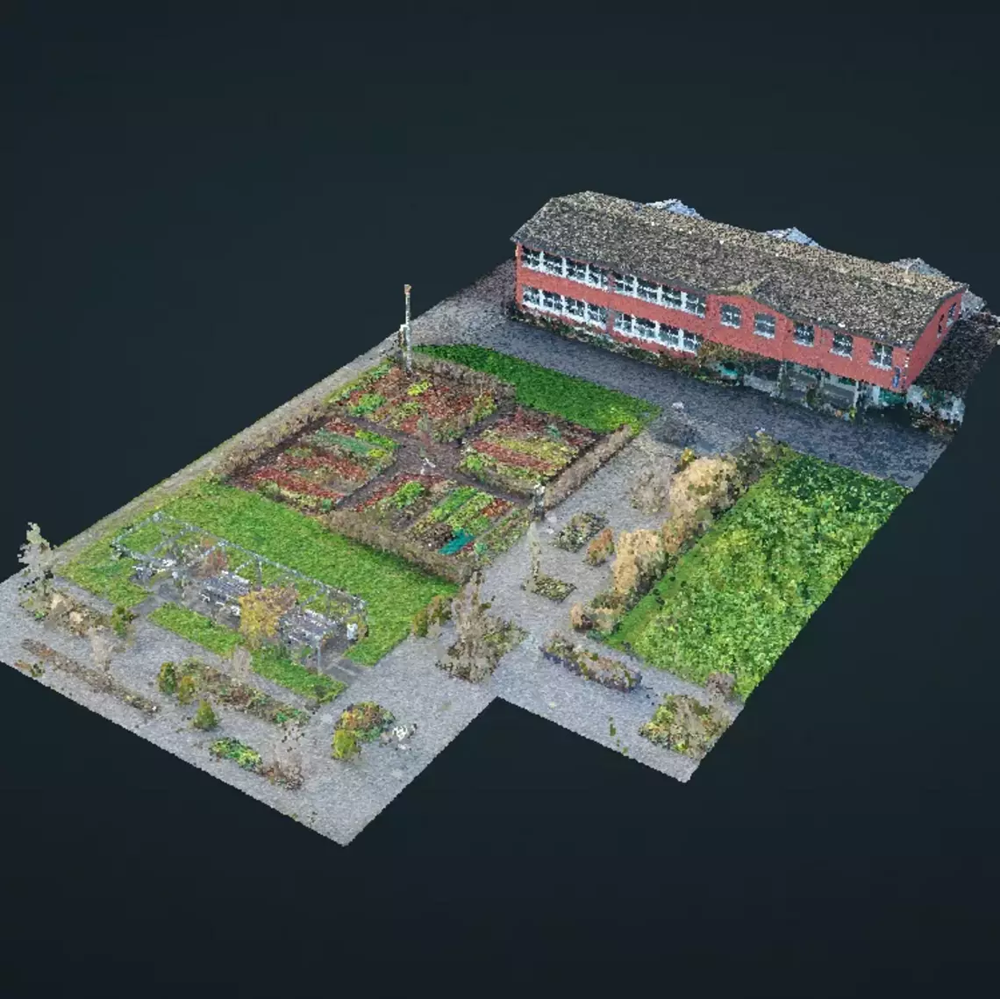
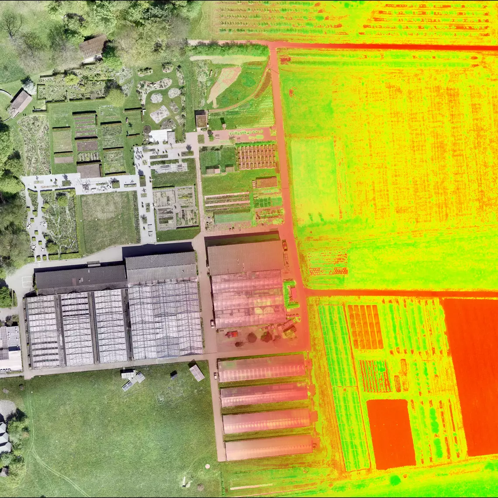
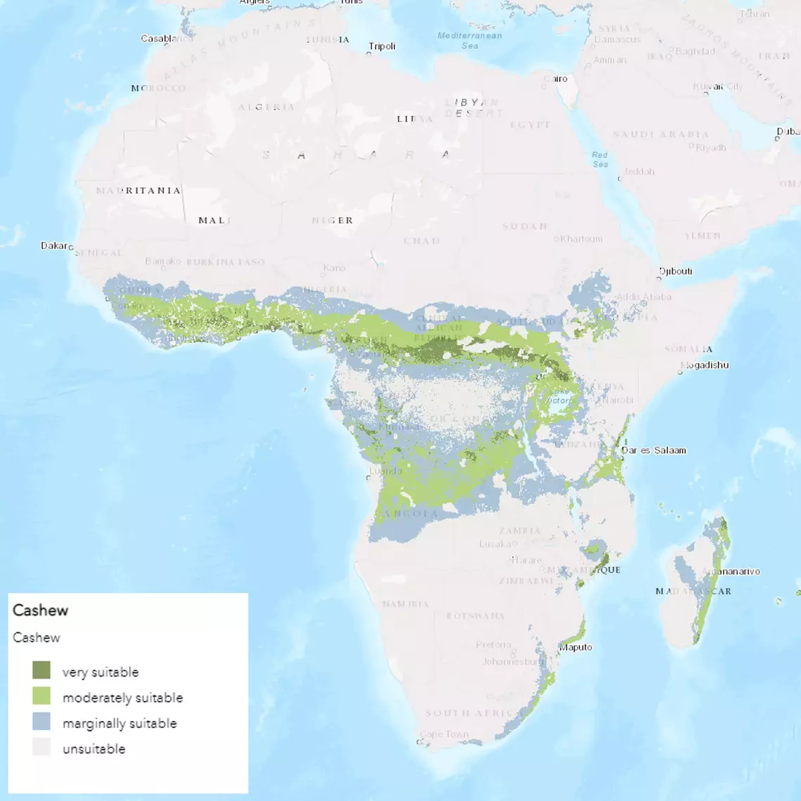
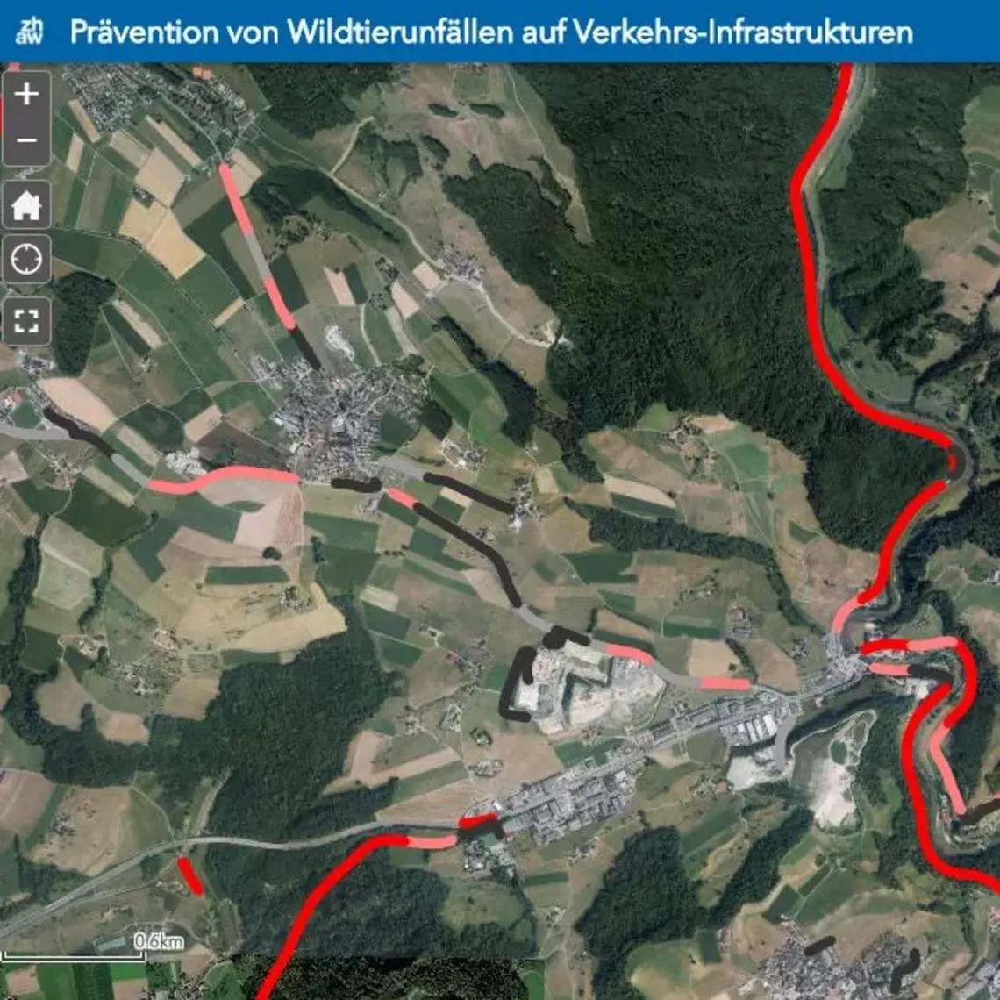
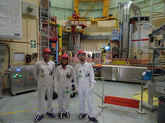
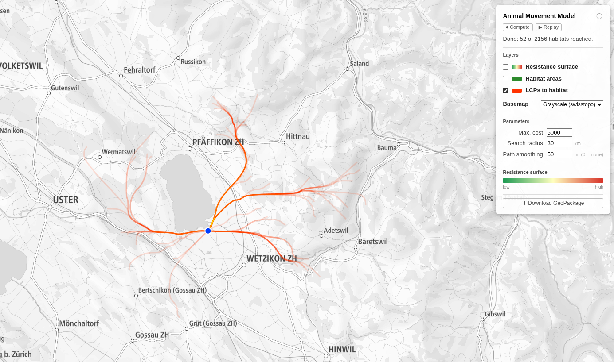
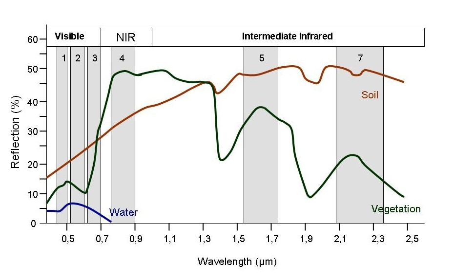

---
title-slide-attributes:
  data-background-image: images/cloud.jpeg
  data-background-size: cover
---


# Einführung

:::: {.columns #info}
::: {.column width="30%"}
{#fi-profile}
:::

::: {.column width="60%" #info .no-bullets}
- Nils Ratnaweera
- ZHAW School of Life Sciences and Facility Management
- Institut für Umwelt und Natürliche Ressourcen
- Grüentalstrasse 14
- 8820 Wädenswil
- <br>
- +41 (0) 58 934 55 63
- nils.ratnaweera@zhaw.ch
- <br>
- Position an der ZHAW
- Research Associate in der Forschungsgruppe Geoinformatik
- www.zhaw.ch/iunr/geoinformatik

:::
::::

## Program

::: {.list-table}
- - 
  - 

- - `08:00 - 08:35`
  - Einführung und theoretischer Input

- - `08:50 - 09:35`
  - Hands-on Einführung in JavaScript

- - `09:50 - 10:35`
  - GEE Demos (Hands-on)

- - `10:50 - 11:35`
  - *s.o.*

- - Lunch Break
  - 

- - `13:00 - 13:35`
  - Individuelle GEE Projekte

- - `13:50 - 14:35`
  - *s.o.*

- - `14:50 - 15:15`
  - *s.o.*

- - `15:30 - 16:35`
  - Exkursion 

:::

## FG Geoinformatik {.smaller}

<div style="display: grid; grid-template-columns: repeat(5, 1fr); text-align: center; gap: 1rem; align-items: start;">

<div>
{style="border-radius: 50%; width: object-fit: cover;"}

Patrick Laube
</div>

<div>
{style="border-radius: 50%; object-fit: cover;"}

Pascal Ochsner
</div>

<div>
{style="border-radius: 50%; object-fit: cover;"}

Johann Junghardt
</div>

<div>
{style="border-radius: 50%; object-fit: cover;"}

Hanno Rahn
</div>

<div>
{style="border-radius: 50%; object-fit: cover;"}

Evelyn Terzer
</div>

</div>

## Themenfelder {.smaller}

:::: {.r-hstack}

::: {.r-vstack}
{width="100%" style="border-radius: 50%; aspect-ratio: 1; object-fit: cover;"}

Drones
:::

::: {.r-vstack}
{width="100%" style="border-radius: 50%; aspect-ratio: 1; object-fit: cover;"}

Ecological Monitoring
:::

::: {.r-vstack}
{width="100%" style="border-radius: 50%; aspect-ratio: 1; object-fit: cover;"}

MCA
:::

::: {.r-vstack}
{width="100%" style="border-radius: 50%; aspect-ratio: 1; object-fit: cover;"}

Spatiotemporal ML
:::

::::

## {.smaller}

<div style="display: grid; grid-template-columns: 30% 70%; gap: 2rem; align-items: center;">

<div style="text-align: center;">
{style="border-radius: 50%; aspect-ratio: 1; object-fit: cover;"}

**Meggie Krymowsky**
</div>

<div>
> Direkt nach dem Studium durfte ich spannende Projekte umsetzen – von Digital Twin bei der Axpo bis hin zu Satellitendaten-Analysen und Machine Learning. Dank des breit gefächerten Studiums habe ich ein starkes Grundverständnis, das es mir leicht macht, auch in neuen Themen schnell Lösungen zu finden.
</div>

</div>

## Zeckenprojekt

<div style="display: grid; grid-template-columns: 1fr 1fr; gap: 1.5rem;">

<div>
<iframe src="https://www.youtube.com/embed/WAh6Rh8Qx8g" width="100%" height="350px" style="border: none;" allowfullscreen></iframe>
</div>

<div>
<iframe src="https://map.geo.admin.ch/#/map?lang=de&center=2660275.73,1197076.95&z=1.661&topic=ech&layers=ch.bag.zeckenstichmodell&bgLayer=ch.swisstopo.pixelkarte-farbe" width="100%" height="350px" style="border: none;"></iframe>
</div>

</div>

## Ausbreitungsmodellierung

[{width="100%"}](https://gis.zhaw.ch/wildlife-connectivity){target="_blank"}

## Was können Sie nach heute?

- Satelliten- und Drohnendaten in der Cloud analysieren
- Vegetationsindizes und Landnutzungsklassifikationen berechnen
- Ergebnisse für eigene Forschungsfragen anwenden
- Unsere Forschungsgruppe sowie mögliche Themenfelder nach Abschluss des Studiums kennen


## Arbeitsbereiche

- **Klimarisiken & Naturgefahren**
  - Swiss Re, Axpo, BKW, BAFU, MeteoSchweiz
- **Ökologie & Biodiversität**
  - WWF, IUCN, FAO, UNEP, kantonale Naturschutzämter
- **Infrastruktur & Stadtplanung**
  - swisstopo, ARE, SBB, Gemeinden, Planungsbüros
- **Landwirtschaft & Präzisionsanbau**
  - Agroscope, Fenaco, HAFL, AgriTech-Startups

# Warum in der Cloud? {data-background-image="images/small-fire-butterfly-8224901_1280.jpg"}

## Datenexplosion


::: footer
Quelle: [dlr.de](https://www.dlr.de/eoc/en/desktopdefault.aspx/tabid-12632/22039_read-51751)
:::

::: {.notes}
- Wir befinden uns mitten in einer Explosion von Earth Observation Daten
- Das Datenwachstum übertrifft das Wachstum von Desktop-Festplatten UND Internet-Bandbreitenkapazität
:::


## Paradigmenwechsel

<div style="display: grid; grid-template-columns: 1fr 1fr; gap: 3rem;">

<div style="opacity: 0.5;">
**~~Früher~~**

1. Satellitendaten identifizieren
2. Hunderte GB herunterladen
3. Lokal verarbeiten (Stunden–Tage)
4. Ergebnis teilen

~~Daten → Code~~
</div>

<div>
**Heute**

1. Script schreiben
2. Auf Cloud-Infrastruktur ausführen
3. Ergebnis sofort visualisieren
4. Script teilen

**Code → Daten**
</div>

</div>


## Welche EO Platform?

- Google Earth Engine (GEE)
- Microsoft Planetary Computer (MPC)
- Earth on AWS 
- Sentinel Hub 
- OpenEO 
- Open Data Cube (ODC)
- SEPAL 
- JEODPP 
- pipsCloud 

::: {.notes}
Über die Jahre ist eine große Anzahl von EO-Plattformen entstanden. Kurze Übersicht:

- **GEE**: Der Platzhirsch. Reif, grosse Community, JavaScript & Python API, kostenlos für Forschung & Lehre. Läuft vollständig auf Google-Infrastruktur.
- **Microsoft Planetary Computer (MPC)**: Microsofts Antwort auf GEE (~2021). Python-basiert, STAC/xarray-Ökosystem, Integration mit Azure. Mehr DIY als GEE.
- **Earth on AWS**: Amazon stellt EO-Daten in der Cloud bereit, aber kaum integrierte Analyseumgebung — man baut die Pipeline selbst.
- **Sentinel Hub**: Kommerziell (Sinergise), stark für Sentinel-Daten, OGC-Standards, gute API — aber kostenpflichtig bei grösserem Volumen.
- **OpenEO**: Kein Backend, sondern ein offener API-Standard, der verschiedene Backends (GEE, MPC, EODC...) einheitlich anspricht. R und Python. Ich finde dies besonders vielversprechend.
- **Open Data Cube (ODC)**: Open-Source, läuft auf eigener Infrastruktur. Wird von nationalen Agenturen genutzt (z.B. Digital Earth Australia).
- **SEPAL**: FAO-Plattform für Waldmonitoring, basiert auf ODC. Fokus auf Länder mit begrenzter IT-Infrastruktur.
- **JEODPP**: JRC (EU-Kommission) interne Plattform für Copernicus-Daten. Kaum öffentlich zugänglich.
- **pipsCloud**: Schweizer Plattform (swisstopo/MeteoSchweiz-Umfeld). Noch wenig verbreitet.
:::

## Plattform-Übersicht

Gomes et al. (2020): An Overview of Platforms for Big Earth Observation Data Management and Analysis

[https://doi.org/10.3390/rs12081253](https://doi.org/10.3390/rs12081253)

(etwas oudated, aber in vielen Punkten noch zutreffendd)

::: {.notes}
MPC und AWS fehlen!
:::

## OpenEO


openEO entwickelt eine offene API, um R, Python, JavaScript und andere Clients auf einfache und einheitliche Weise mit großen Earth Observation Cloud-Backends zu verbinden.

::: {.notes}
OpenEO:
- ist ein Open-Source-Projekt
- bietet eine standardisierte API (ist ein Wrapper um bestehende Plattformen)
- dies fügt eine zusätzliche Komplexitätsebene hinzu
- wird am besten über die R-API verwendet, welche den "Cloud"-Aspekt verschleiert
:::

## Plattform-Vergleich

> ...most people prefer GEE mostly because it's the good ol' reliable when it comes to EO data on the cloud. Mature, well-documented and a huge community. 


> MPC [Microsoft Planetary Computer] is the new kid on the block, they provide a more bare-bone version of GEE...

::: footer
[Quelle](https://www.reddit.com/r/remotesensing/comments/16cddfa/confused_on_the_big_data_platforms/)
:::

## CO2-Fußabdruck?

- Der ICT-Sektor verursacht **~2–4%** der globalen CO2-Emissionen — vergleichbar mit dem Luftverkehr
- Rechenzentren verbrauchen **~1–2%** des weltweiten Stroms
- Google gibt an, seit 2007 CO2-neutral zu sein (Kompensation) — das schliesst GEE ein
- Trotzdem: mehr Nutzung = mehr Energie

[cloudcarbonfootprint.org](https://www.cloudcarbonfootprint.org/)

# Google Earth Engine {data-background-image="images/earth-2254769_1280.jpg"}

## Was macht GEE besonders?

<div style="display: grid; grid-template-columns: 1fr 1fr; gap: 2rem;">

<div>
**Datenkatalog**

- Petabytes an Satellitendaten
- Landsat (seit 1972), Sentinel-2, MODIS, ...
- Klimadaten, Geländemodelle, Populationsdaten
- Täglich aktualisiert
</div>

<div>
**Cloud-Computing**

- Keine lokale Installation nötig
- Keine Downloads
- Verarbeitung läuft auf Google-Servern
- Kostenlos für Forschung & Lehre
</div>

</div>

## Bevor wir anfangen...

:::{.callout-note}

## Eingerichtet?

Habt ihr euch bei GEE Registrieren können?
:::

## {data-background-color="gray"}


::: {.notes}
Der Code-Editor versteht nur JavaScript!
:::

## geemap

geemap: Ein Python-Paket für interaktive Geospatial Analysis und Visualisierung mit Google Earth Engine

[geemap.org](https://geemap.org/)


# Einführung in Javascript {data-background-image="images/child-2887483_1280.jpg"}

<small style="text-shadow: 2px 2px #090909;">(sehr kurz)</small>

## Erste Schritte

1. Öffnen Sie ein Browserfenster
2. Drücken Sie `F12`, um die Entwicklertools zu öffnen
3. Gehen Sie zum `console`-Tab
4. Folgen Sie mit! (Demo-Zeit)

::: {.notes}
Gehen Sie den Code in `01-browser-console-demo.md` durch
:::

## Zusammenfassung

## Variablen-Deklaration

```javascript
// Variablen werden verwendet, um Objekte zu speichern und werden
// mit dem Schlüsselwort var definiert.
var the_answer = 42;

// String-Objekte beginnen und enden mit Anführungszeichen.
var my_variable = "I am a string";
```

## Variablen-Deklaration

```javascript
// es gibt andere Wege, Variablen in js zu deklarieren
let the_answer = 42;
const the_answer = 42;
// diese ignorieren wir
```

## Anweisungen

```javascript
// Anweisungen *sollten* mit einem Semikolon enden
var test = 'I feel incomplete...'

var test = 'I feel complete...';
```

## HTML Script Einrichtung

1. Öffnen Sie einen **Texteditor**
2. Erstellen Sie eine Datei mit der Endung `.html`
3. Erstellen Sie ein `script`-Tag

```html
<script>

</script>
```

4. Öffnen Sie diese Datei im Browser
5. Folgen Sie mit! (Demo-Zeit)

::: {.notes}
Gehen Sie das Script `02-basic-html-script-demo.md` durch
:::

## Aufgabe 1

1. Erstellen Sie eine Variable `myname` mit Ihrem Namen
2. Erstellen Sie eine Variable `myage` mit Ihrem Alter
3. Berechnen Sie Ihr Alter in Tagen und speichern Sie es in `myage_days`
4. Geben Sie auf der Konsole aus: `Hi, my name is ... and I am ... days old`

::: {.notes}
Lösung ist in `03-basic-html-script-task.md`
:::

## Demo geht weiter...

::: {.notes}
Gehen Sie das Script `04-basic-html-script-demo.md` durch
:::

## Aufgabe 2

- Erstellen Sie eine Funktion, die eine Anzahl von Jahren in eine Anzahl von Tagen umwandelt
- Nennen Sie die Funktion `years2days`

```javascript
// dies ist die Syntax zum Erstellen einer Funktion:
function say_something(what){
    // mache etwas
};
```

::: {.notes}
Lösung ist in `05-function-years2days-task.md`
:::

## Demo geht weiter...

::: {.notes}
Lösung ist in `06-introduction-to-methods-demo.md`
:::

## Zusammenfassung

## Kommentare

```javascript
// Zeilenkommentare beginnen mit zwei Schrägstrichen.
// Wie diese Zeile.

/*
Mehrzeilige Kommentare beginnen mit einem Schrägstrich
und einem Stern,
und enden mit einem Stern und einem Schrägstrich.
*/
```

## Arrays

```javascript
// Eckige Klammern werden verwendet, um eine Liste von Elementen zu erstellen
var my_list = ['eggplant', 'apple', 'wheat'];

// Eckige Klammern werden auch verwendet, um Elemente in
// einer Liste auszuwählen. 0 bezieht sich auf das erste Element in der Liste.
my_list[0];
```

## Dictionaries

```javascript
// Geschweifte Klammern werden verwendet, um "Wörterbücher" zu definieren
var my_dict = {'food':'bread', 'color':'red', 'number':42};

// Eckige Klammern werden verwendet, um auf Elemente zuzugreifen (nach Schlüssel).
my_dict['color'];

// Oder Sie können die Punkt-Notation verwenden, um das gleiche Ergebnis zu erhalten.
my_dict.color;
```

## Functions

```javascript
// Funktionen können definiert werden, um Code zu wiederverwenden und
// ihn leichter lesbar zu machen.
function years2days(years){
    return years*365
};

years2days(34);
```

## Functions (Alternative Syntax)

```javascript
// Funktionen können definiert werden, um Code zu wiederverwenden und
// ihn leichter lesbar zu machen.
var say_hello = function(string) {
    return 'Hello ' + string + '!';
};

say_hello('world');
```

# Javascript in Webseiten {data-background-image="images/worker-5736096_1280.jpg"}

## Die Web-Trinität

JS ist Teil einer **Trinität**, die den größten Teil des Webs definiert


## Lass uns erkunden

Lassen Sie uns diese Gelegenheit nutzen, um dies zu erkunden und zu verstehen.

(Demo-Zeit)

::: {.notes}
Gehen Sie das Script `07-years2days-website.md` durch
:::

## Challenge

Erstellen Sie eine Anwendung, die Ihren Namen als Eingabe nimmt und den Namen rückwärts zurückgibt.

Tipp: Verwenden Sie die Methoden `split`, `reverse` und `join`

::: {.notes}
Lösung ist in `08-reverse-name-website.html`
:::

# Erste Schritte in Google Earth Engine {data-background-image="images/turtle-2201433_1280.jpg"}

## Anweisungen

1. Gehen Sie zu [code.earthengine.google.com](https://code.earthengine.google.com)
2. Spielen Sie mit dem Code-Editor herum (erstellen Sie Variablen, Wörterbücher, Listen...)
3. Navigieren Sie zu einem Ort, den Sie kennen (z.B. Ihre Heimatstadt) über die Suchleiste
4. Suchen Sie nach einem Datensatz in der Suchleiste
5. Erstellen Sie ein Repo (*New*→*Repo*) namens *DigitalLifeScience Demos*
6. Erstellen Sie eine neue Datei in diesem Repo namens *Demo_1*

## Demo 1: Unispectral Data

::: {.notes}
Führen Sie die Demo *Demo 1: Unispectral Data* durch
:::

## Aufgabe: Standortauswahl für Erneuerbare Energien

Identifizieren Sie geeignete Gebiete für die Installation erneuerbarer Energien:

- Höhe: 500 - 1000 m ü. M.
- Neigung: 3 - 6°
- Ausrichtung: Südausrichtung, zwischen 135° und 225°

## Demo 2: Multispektrale Daten

## Elektromagnetisches Spektrum in Sentinel S2

{style="background-color: white;"}

::: {.notes}
- VIS: Sichtbares Licht
- NIR: Nahinfrarot
- SIWIR: Kurzwellen-IR
- TIR: Thermisches IR
:::

## Erstellen Sie ein Echtfarben-Bild

Erstellen Sie ein *Echtfarben-Bild* aus den R-/G-/B-Bändern

## Demo 3: Multispektral NDVI

Ziel: Berechnen Sie den **NDVI** für ein Gebiet Ihrer Wahl und visualisieren Sie die Vegetationsverteilung.

::: {.notes}
Führen Sie die Demo *Demo 3: Multispektral NDVI* durch
:::

## NDVI: Normalized Difference Vegetation Index


## Warum NIR und Red?



::: {.notes}
- Vegetation absorbiert rotes Licht stark (Photosynthese) → niedrige Red-Reflexion
- Vegetation reflektiert NIR stark (Zellstruktur der Blätter) → hohe NIR-Reflexion
- Boden: ähnliche Reflexion in Red und NIR → NDVI nahe 0
- Wasser: absorbiert NIR fast vollständig → negativer NDVI
- Dieses Kontrastverhältnis macht NDVI so aussagekräftig
:::

## NDVI Formula

$$\text{NDVI} = \frac{\text{NIR}-\text{Red}}{\text{NIR}+\text{Red}}$$

In Sentinel-2: **NIR = Band 8**, **Red = Band 4**

## NDVI Interpretation

| NDVI Wert | Bedeutung |
|-----------|-----------|
| < 0       | Wasser, Schnee, Wolken |
| 0.0 – 0.2 | Nackter Boden, urbane Flächen |
| 0.2 – 0.4 | Spärliche Vegetation, Grasland |
| 0.4 – 0.6 | Moderate Vegetation, Landwirtschaft |
| > 0.6     | Dichter Wald, üppige Vegetation |

::: {.notes}
- NDVI reicht von -1 bis +1
- Gesunde Pflanzen absorbieren rotes Licht (Photosynthese) und reflektieren NIR stark
- Deshalb: hoher NIR, niedriger Red → hoher NDVI
:::


## Demo 5: Waldnachwachstum

# Ihr eigenes Projekt in Google Earth Engine {data-background-image="images/turtle-1850190_1280.jpg"}

## Nachmittagsaufgabe

Deine Aufgabe für heute Nachmittag:

1. Wähle ein Gewässer deiner Wahl (z.B. Grimselsee, Lago di Lugano, Zürichsee) und berechne den **NDWI** über mehrere Jahre
2. Vergleiche ein Trockenjahr (z.B. 2018 oder 2022) mit einem Normaljahr und visualisiere die Unterschiede
3. Lade deine Ergebnisse (z.B. als CSV oder GeoTIFF) auf deine lokale Festplatte herunter
4. Optional: Schreibe eine kurze Beschreibung deiner Analyse und deiner Ergebnisse (verwende Jupyter, Rmarkdown oder Quarto)

# Leistungsnachweis {data-background-image="images/sunflowers-8980921_1280.jpg" visibility="hidden"}

## Aufgabendetails{visibility="hidden"}}

Wenden Sie ihr gelerntes Wissen aus beiden Einheiten an, um Ihr eigenes Forschungsprojekt zu entwerfen und auszuarbeiten. Beschreiben Sie die Motivation, einen geeigneten Analyseansatz und anwendbare Remote Sensing Daten.

Der kurze Forschungsantrag soll eine Seite nicht überschreiten und kann eine Abbildung enthalten.

Abgabetermin ist eine Woche nach der letzten Remote Sensing Sitzung (2.10.2025)


