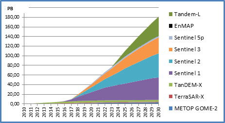
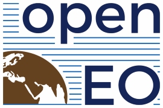
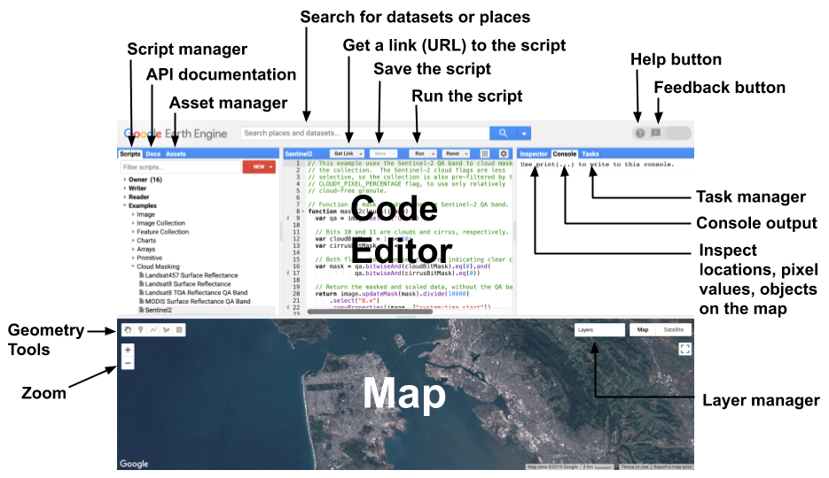
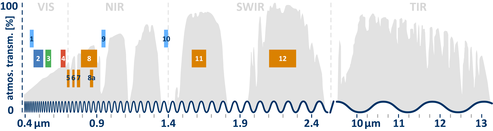
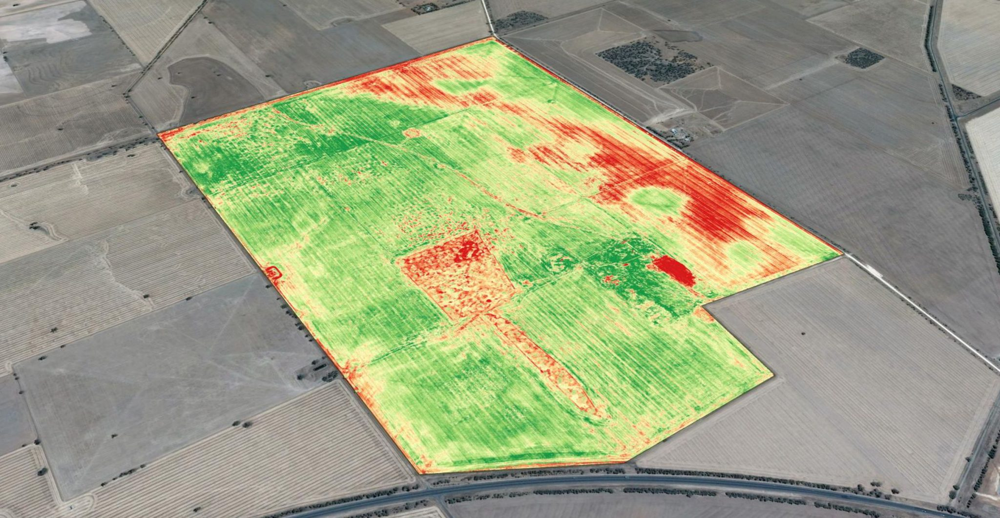

---
title-slide-attributes:
  data-background-image: images/cloud.jpeg
  data-background-size: cover
---


:::: {.columns}
::: {.column width="30%"}
{#fi-profile}
:::

::: {.column width="60%" #info .no-bullets}
- Nils Ratnaweera
- ZHAW School of Life Sciences and Facility Management
- Institut für Umwelt und Natürliche Ressourcen
- Grüentalstrasse 14
- 8820 Wädenswil
- <br>
- +41 (0) 58 934 55 63
- nils.ratnaweera@zhaw.ch
- <br>
- Position an der ZHAW
- Research Associate in der Forschungsgruppe Geoinformatik
- www.zhaw.ch/iunr/geoinformatik

:::
::::


# Remote Sensing {data-background-image="images/atmosphere_geo5_2018235_lrg.jpg" data-background-size="contain"}


## {data-background-image="images/Capella-Space-Rodnykivka-airfield-1.jpg" data-background-size="contain"}


## 




## {data-background-image="images/remotesensing-12-01949-g002-540943033.png" data-background-size="contain"}

Quelle: www.vrogue.co


# Warum in der Cloud? {data-background-image="images/small-fire-butterfly-8224901_1280.jpg"}

## Datenexplosion



Quelle: [dlr.de](https://www.dlr.de/eoc/en/desktopdefault.aspx/tabid-12632/22039_read-51751)

::: {.notes}
- Wir befinden uns mitten in einer Explosion von Earth Observation Daten
- Das Datenwachstum übertrifft das Wachstum von Desktop-Festplatten UND Internet-Bandbreitenkapazität
:::


## Paradigmenwechsel 


- ~~Daten → Code~~
- Code → Daten


## Welche EO Platform?

- Google Earth Engine (GEE)
- Microsoft Planetary Computer (MPC)
- Earth on AWS 
- Sentinel Hub 
- OpenEO 
- Open Data Cube (ODC)
- SEPAL 
- JEODPP 
- pipsCloud 

::: {.notes}
Über die Jahre ist eine große Anzahl von EO-Plattformen entstanden.
Ich finde die openEO-Plattform besonders vielversprechend
:::

## Plattform-Übersicht

Gomes et al. (2020): An Overview of Platforms for Big Earth Observation Data Management and Analysis

[https://doi.org/10.3390/rs12081253](https://doi.org/10.3390/rs12081253)

(veraltet)

::: {.notes}
MPC und AWS fehlen!
:::

## OpenEO



openEO entwickelt eine offene API, um R, Python, JavaScript und andere Clients auf einfache und einheitliche Weise mit großen Earth Observation Cloud-Backends zu verbinden.

::: {.notes}
OpenEO:
- ist ein Open-Source-Projekt
- bietet eine standardisierte API (ist ein Wrapper um bestehende Plattformen)
- dies fügt eine zusätzliche Komplexitätsebene hinzu
- wird am besten über die R-API verwendet, welche den "Cloud"-Aspekt verschleiert
:::

## Plattform-Vergleich

> ...die meisten Leute bevorzugen GEE hauptsächlich, weil es das gute alte zuverlässige System ist, wenn es um EO-Daten in der Cloud geht. Ausgereift, gut dokumentiert und eine riesige Community.
>
> MPC ist der neue Spieler im Feld, sie bieten eine abgespeckte Version von GEE mit dem zusätzlichen Vorteil, die eigene Computing-Umgebung auf Azure zu verbinden.

[Quelle](https://www.reddit.com/r/remotesensing/comments/16cddfa/confused_on_the_big_data_platforms/)

## CO2-Fußabdruck?

[cloudcarbonfootprint.org](https://www.cloudcarbonfootprint.org/)

::: {.notes}
- Cloud Computing ist ein wichtiger Beitrag zur globalen Erwärmung
- Es gibt eine Reihe von Tools zur Berechnung des CO2-Fußabdrucks Ihrer Cloud-Nutzung
- Es ist wichtig, sich dessen bewusst zu sein
:::

# Google Earth Engine {data-background-image="images/earth-2254769_1280.jpg"}

## {data-background-color="gray"}



::: {.notes}
Der Code-Editor versteht nur JavaScript!
:::

## geemap

geemap: Ein Python-Paket für interaktive Geospatial Analysis und Visualisierung mit Google Earth Engine

[geemap.org](https://geemap.org/)


# Einführung in Javascript {data-background-image="images/child-2887483_1280.jpg"}

<small style="text-shadow: 2px 2px #090909;">(sehr kurz)</small>

## Erste Schritte

1. Öffnen Sie ein Browserfenster
2. Drücken Sie `F12`, um die Entwicklertools zu öffnen
3. Gehen Sie zum `console`-Tab
4. Folgen Sie mit! (Demo-Zeit)

::: {.notes}
Gehen Sie den Code in `01-browser-console-demo.md` durch
:::

## Zusammenfassung

## Variablen-Deklaration

```javascript
// Variablen werden verwendet, um Objekte zu speichern und werden
// mit dem Schlüsselwort var definiert.
var the_answer = 42;

// String-Objekte beginnen und enden mit Anführungszeichen.
var my_variable = "I am a string";
```

```javascript
// es gibt andere Wege, Variablen in js zu deklarieren
let the_answer = 42;
const the_answer = 42;
// diese ignorieren wir
```

## Anweisungen

```javascript
// Anweisungen *sollten* mit einem Semikolon enden
var test = 'I feel incomplete...'

var test = 'I feel complete...';
```

## HTML Script Einrichtung

1. Öffnen Sie einen **Texteditor**
2. Erstellen Sie eine Datei mit der Endung `.html`
3. Erstellen Sie ein `script`-Tag

```html
<script>

</script>
```

4. Öffnen Sie diese Datei im Browser
5. Folgen Sie mit! (Demo-Zeit)

::: {.notes}
Gehen Sie das Script `02-basic-html-script-demo.md` durch
:::

## Aufgabe 1

1. Erstellen Sie eine Variable `myname` mit Ihrem Namen
2. Erstellen Sie eine Variable `myage` mit Ihrem Alter
3. Berechnen Sie Ihr Alter in Tagen und speichern Sie es in `myage_days`
4. Geben Sie auf der Konsole aus: `Hi, my name is ... and I am ... days old`

::: {.notes}
Lösung ist in `03-basic-html-script-task.md`
:::

## Demo geht weiter...

::: {.notes}
Gehen Sie das Script `04-basic-html-script-demo.md` durch
:::

## Aufgabe 2

- Erstellen Sie eine Funktion, die eine Anzahl von Jahren in eine Anzahl von Tagen umwandelt
- Nennen Sie die Funktion `years2days`

```javascript
// dies ist die Syntax zum Erstellen einer Funktion:
function say_something(what){
    // mache etwas
};
```

::: {.notes}
Lösung ist in `05-function-years2days-task.md`
:::

## Demo geht weiter...

::: {.notes}
Lösung ist in `06-introduction-to-methods-demo.md`
:::

## Zusammenfassung

## Kommentare

```javascript
// Zeilenkommentare beginnen mit zwei Schrägstrichen.
// Wie diese Zeile.

/*
Mehrzeilige Kommentare beginnen mit einem Schrägstrich
und einem Stern,
und enden mit einem Stern und einem Schrägstrich.
*/
```

## Arrays

```javascript
// Eckige Klammern werden verwendet, um eine Liste von Elementen zu erstellen
var my_list = ['eggplant', 'apple', 'wheat'];

// Eckige Klammern werden auch verwendet, um Elemente in
// einer Liste auszuwählen. 0 bezieht sich auf das erste Element in der Liste.
my_list[0];
```

## Wörterbücher

```javascript
// Geschweifte Klammern werden verwendet, um "Wörterbücher" zu definieren
var my_dict = {'food':'bread', 'color':'red', 'number':42};

// Eckige Klammern werden verwendet, um auf Elemente zuzugreifen (nach Schlüssel).
my_dict['color'];

// Oder Sie können die Punkt-Notation verwenden, um das gleiche Ergebnis zu erhalten.
my_dict.color;
```

## Funktionen

```javascript
// Funktionen können definiert werden, um Code zu wiederverwenden und
// ihn leichter lesbar zu machen.
function years2days(years){
    return years*365
};

years2days(34);
```

## Funktionen (Alternative Syntax)

```javascript
// Funktionen können definiert werden, um Code zu wiederverwenden und
// ihn leichter lesbar zu machen.
var say_hello = function(string) {
    return 'Hello ' + string + '!';
};

say_hello('world');
```

# Javascript in Webseiten {data-background-image="images/worker-5736096_1280.jpg"}

## Die Web-Trinität

JS ist Teil einer **Trinität**, die den größten Teil des Webs definiert


## Lass uns erkunden

Lassen Sie uns diese Gelegenheit nutzen, um dies zu erkunden und zu verstehen.

(Demo-Zeit)

::: {.notes}
Gehen Sie das Script `07-years2days-website.md` durch
:::

## Herausforderung

Erstellen Sie eine Anwendung, die Ihren Namen als Eingabe nimmt und den Namen rückwärts zurückgibt.

Tipp: Verwenden Sie die Methoden `split`, `reverse` und `join`.

::: {.notes}
Lösung ist in `08-reverse-name-website.html`
:::

# Erste Schritte in Google Earth Engine {data-background-image="images/turtle-2201433_1280.jpg"}

## Anweisungen

1. Gehen Sie zu [code.earthengine.google.com](https://code.earthengine.google.com)
2. Spielen Sie mit dem Code-Editor herum (erstellen Sie Variablen, Wörterbücher, Listen...)
3. Navigieren Sie zu einem Ort, den Sie kennen (z.B. Ihre Heimatstadt) über die Suchleiste
4. Suchen Sie nach einem Datensatz in der Suchleiste
5. Erstellen Sie ein Repo (*New*→*Repo*) namens *DigitalLifeScience Demos*
6. Erstellen Sie eine neue Datei in diesem Repo namens *Demo_1*

## Demo 1: Unispectral Data

::: {.notes}
Führen Sie die Demo *Demo 1: Unispectral Data* durch
:::

## Aufgabe: Standortauswahl für Erneuerbare Energien

Identifizieren Sie geeignete Gebiete für die Installation erneuerbarer Energien:

- Höhe: 500 - 1000 m ü. M.
- Neigung: 3 - 6°
- Ausrichtung: Südausrichtung, zwischen 315° und 45°

## Demo 2: Multispektrale Daten

## Elektromagnetisches Spektrum in Sentinel S2

{style="background-color: white;"}

::: {.notes}
- VIS: Sichtbares Licht
- NIR: Nahinfrarot
- SIWIR: Kurzwellen-IR
- TIR: Thermisches IR
:::

## Erstellen Sie ein Echtfarben-Bild

Erstellen Sie ein *Echtfarben-Bild* aus den R-/G-/B-Bändern

## Demo 3: Multispektral NDVI

## NDVI: Normalized Difference Vegetation Index



## NDVI Formula

$$\text{NDVI} = \frac{\text{NIR}-\text{Red}}{\text{NIR}+\text{Red}}$$


## Demo 5: Waldnachwachstum

# Ihr eigenes Projekt in Google Earth Engine {data-background-image="images/turtle-1850190_1280.jpg"}

## Nachmittagsaufgabe

Ihre Aufgabe für heute Nachmittag:

1. Implementieren Sie eine der gezeigten Analysen für ein anderes Gebiet (oder setzen Sie Ihre eigene Idee um)
2. Laden Sie Ihre Ergebnisse (z.B. als CSV) auf Ihre lokale Festplatte herunter
3. Schreiben Sie eine kurze Beschreibung Ihrer Analyse und Ihrer Ergebnisse (verwenden Sie Jupyter, Rmarkdown oder Quarto)
4. (Optional): Senden Sie per E-Mail an rata@zhaw.ch

# Benotete Aufgabe {data-background-image="images/sunflowers-8980921_1280.jpg"}

## Aufgabendetails

Wenden Sie das Fachwissen und die Fähigkeiten an, die Sie in den beiden Remote Sensing Sitzungen erworben haben, um Ihr eigenes Forschungsprojekt zu entwerfen und auszuarbeiten. Beschreiben Sie die Motivation, einen geeigneten Analyseansatz und anwendbare Remote Sensing Daten.

Der kurze Forschungsantrag soll eine Seite nicht überschreiten und kann eine Abbildung enthalten.

Abgabetermin ist eine Woche nach der letzten Remote Sensing Sitzung (2.10.2025)


